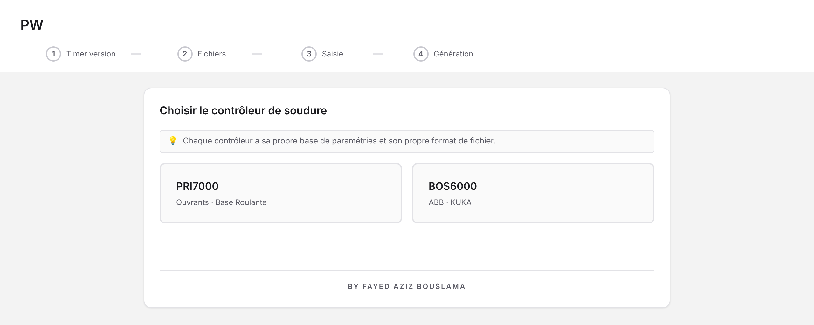
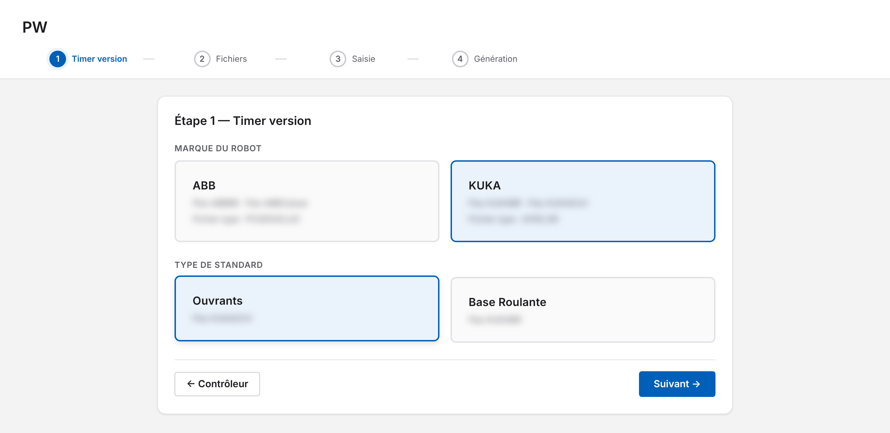
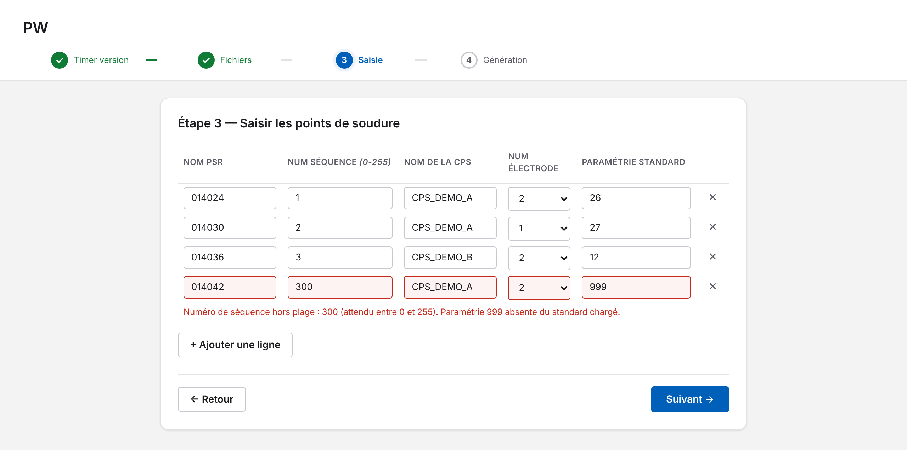
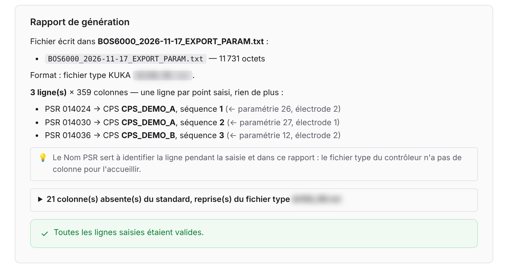

# PW — Weld-point programming file generator

-blue)

**PW** is a Windows desktop application that generates the configuration files loaded into
industrial **weld timers** (PRI7000 and BOS6000 controllers) driving **ABB** and **KUKA** spot-welding
robots. It replaces a manual, error-prone copy-and-paste process in Excel with a guided 4-step
workflow that produces import-ready files in seconds.

> **About this repository.** The application embeds industrial reference files (weld-parameter
> standards and file templates) that are confidential, so the source code is kept in a **private
> repository**. This page presents the project: problem, design, testing and screenshots.
> A live demo or a walkthrough of the source code is available on request.

---

## The problem

Each weld point of a robot cell has to be programmed in the weld timer: a sequence number, an
electrode, and a full set of weld parameters copied from a reference standard. The files involved
have **300+ columns** and 256 parameter sets each. Before PW, they were assembled by hand in Excel,
which is slow and, worse, **silently corrupts the data**:

| Value in the controller file | What Excel turns it into |
|---|---|
| Weld point name `014024` | the number `14024` (leading zero lost) |
| A date such as `01.01.2002 00:00:00` | a serial number (`37257`) |
| A field padded with trailing spaces | trimmed spaces |
| Decimal values such as `10.25` | rounded or localised (`10,25`) |

A single corrupted cell can be rejected by the controller or, worse, accepted with wrong values.

## What PW does

1. **Controller and robot** — choose PRI7000, or BOS6000 with the robot brand (ABB / KUKA) and the
   standard type (doors and closures, or underbody).
2. **Reference files** — the matching standard and output template are loaded automatically. Any
   other standard can be loaded: only its **structure** is checked, never its file name.
3. **Weld points** — one row per point (point name, sequence number, controller program, electrode,
   parameter set). Rows can be pasted directly from Excel. Each row is validated as you type and
   errors are shown line by line without blocking the other rows.
4. **Generation** — one file in the controller's native format (`.txt`, `.xlsx` or `.xml`), plus a
   generation report that lists exactly what was written and where every value came from.

**PW never computes a weld parameter.** Every value it writes comes unchanged from the reference
standard, the template, or the operator's input. Everything runs locally; no data leaves the computer.

## Screenshots

The user interface is in French, the language of its users. Demo data only; names of confidential
reference files are blurred.

**Choosing the weld controller**

**Step 1 — robot brand and standard type**

**Step 3 — weld-point input with row-by-row validation** (the last row is rejected: sequence 300 is
out of range 0–255 and parameter set 999 does not exist in the loaded standard)

**Step 4 — generation report** (one output row per weld point, with the origin of each value)

## Engineering highlights

- **Columns are matched by name, never by position.** The two robot brands use output templates
  with different column counts, and standards may differ from the template. Missing and extra
  columns are detected and listed in the report instead of being silently shifted.
- **Byte-exact file formats.** Latin-1 encoding, CRLF line endings, a trailing `;` after every field,
  significant space padding. Reference files are stored with Git line-ending conversion disabled so
  that they are restored byte for byte on every clone.
- **Type safety against Excel.** Every value of the output model must be a string; the writer
  refuses to write anything else, so a leading zero can never be lost upstream.
- **Clean architecture.** Business logic is written as pure ES modules with no dependency on the
  browser or on Node, so it is tested directly with Node on the same files as in production. Only
  the UI layer touches the DOM. Output formats are pluggable writers behind a common contract:
  adding a format changes neither the business logic nor the UI. The Excel library (SheetJS) is
  loaded only when the workflow that needs it is opened.
- **Secure desktop shell.** Electron with context isolation on and Node integration off: the window
  reaches the system only through a minimal preload bridge (file saving, embedded resources).

## Testing and quality

- **215 automated tests** (`node:test`), run on every push by **GitHub Actions on Windows**.
- **Byte-for-byte non-regression tests**: reference outputs were frozen before a new controller was
  added, and every commit must reproduce them exactly.
- **Exhaustive audit**: every standard × every parameter set × every column of the output template
  is generated and compared with the source text, cell by cell — **345,088 comparisons**. The test
  deliberately offsets the parameter set from the sequence number (so reading the wrong row cannot
  pass by accident) and uses its own independent parser (so a symmetric read/write bug cannot cancel
  out).
- **Round-trip tests** on the real controller files (`.txt`, and a 2.5 MB `.xml` export).
- **End-to-end acceptance script** that drives the real Electron application (clicks, pasting from
  Excel, generation) and checks the bytes produced.

## Delivery

- Windows installer (NSIS) built with electron-builder; versions published as GitHub Releases.
- Semantic versioning and a changelog: v1.0.0 (August 2026) → v1.2.1 (October 2026).
- Detailed commit history: each commit message records the problem, the decision and how it was
  verified.

## Tech stack

JavaScript (ES modules) · HTML/CSS · Electron 33 · electron-builder · SheetJS · Node.js 24 test
runner · GitHub Actions

About 2,600 lines of application code in 21 modules, and about 2,650 lines of tests.

## Development

Developed by **Fayed Aziz Bouslama** in 2026. The private repository's history records every change and its rationale.

---

© 2026 Fayed Aziz Bouslama. All rights reserved. Screenshots and text may not be reused without
permission.
